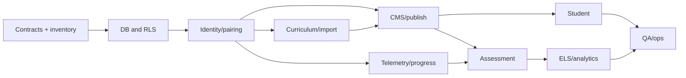

# BreakNLearn — Instructions to the Lead Coding Agent

You are the ORCHESTRATOR for a complete, production-grade implementation. This file is an executable work order, NOT a request for a high-level proposal. Read `../spec/00_MASTER_IMPLEMENTATION_SPEC.md` fully first, then all files in `../contracts`, `../testing`, `../operations` and the visual PDF. Do not skip the existing application inventory.

## Non-negotiable outcomes

1. Code must run locally with no production credentials, reproducible from README.
2. Produce deployable apps for student and authenticated adult/admin, a secure DB and API, content authoring/publishing, telemetry, assessments, ELS, analytics, import/mapping and test coverage.
3. Preserve `breaknlearn.vercel.app` existing project, brand and live behavior, two profiles, Grade 2/6 subject arrays, Grade 2 ×1–×10 only published, six worlds, seven-second slides, quiz, music, resume.
4. Do not assume the CMS prototype is production-ready or the 80 topic outlines verbatim official standards.
5. No browser-accessible child data without adult household authorization; no live production action until credentials and owner consent are available.
6. Implement and verify RLS grants and device capability identity; protect school-upload storage. No embedded password or client service key.
7. When blocked from external services, build fully working local implementations with adapters/mocks, then document exact configuration prerequisites.

## Startup sequence — must be done in order

**Phase 0A inventory:** inspect actual source (Git/Vercel snapshot); run existing app locally, capture screenshot and smoke tests; document browser behavior and legacy localStorage payload examples; verify Vercel project/name. If source is not retrievable, create a new repo with a faithful compatibility port and provide a documented migration plan; do not falsely claim to have refactored inaccessible source.

**Phase 0B contracts freeze:** inspect the provided SQL blueprint and OpenAPI/event schemas. Fix any schema defects; define Zod schemas and generated TypeScript SDK; verify any incompatible fields in ADR. Publish contract package on branch `foundation/contracts`. All agents then import that package. Conventions: TS strict; consistent snake_case DB and JSON fields (map to camelCase only in client adapters); server ISO timestamps UTC; UUID IDs; role checks in server BFF; explicit error contracts.

**Phase 0C task partition:** choose specialist agents from below; use independent branches/worktrees with exclusive file ownership. The orchestrator alone owns dependency upgrades, shared tsconfig, root package files, CI merges, and deployment. Agents must return code, tests, changed files, command evidence, blocked items, API interface diffs, and risks. Integrate serially based on dependency DAG.

## Suggested autonomous subagents (10, expand only if justified)

| Agent | Scope / exclusive directories | Inputs | Required outputs | Depends on |
|---|---|---|---|---|
| A0 Architect/Integrator | root, `packages/contracts`, ADRs | master spec and existing app | workspace, typed schemas, adapters, lockfile | first |
| A1 DB & RLS | `supabase/**`, `db/**` | contracts + schema blueprint | migrations, seeds, RLS/grant tests, indexes | A0 |
| A2 Identity & Security | `packages/auth`, admin auth endpoints, pairing routes | A0+A1 | guardian auth, two profiles, pairing, RBAC test | A1 |
| A3 Curriculum & School Import | `packages/curriculum`, `apps/admin/curriculum`, import routes | source seed/docs, A1 schema | reviewed hierarchy, extract/map pipeline, UI, import tests | A1+A2 |
| A4 CMS Authoring & Publishing | `packages/lesson-engine`, `apps/admin/content`, publish routes | lesson contracts, A1+A2 | template engine, editor preview, gated publishing | A1+A2+A3 |
| A5 Student Integration | `apps/student/**` | legacy code, M05 catalog, device APIs | webOS UI, offline/cache/profile migration, ×1–10 regression | A0+A2+A4 |
| A6 Telemetry & Progress | `packages/telemetry`, session/progress routes | event schema, A1+A2 | durable queue, dedup ingest, progress conflict solver | A1+A2 |
| A7 Assessment & Retention | assessment package/routes | lesson question bank, A6 | baseline/post/delayed, server scoring, review scheduler | A4+A6 |
| A8 Intelligence & Analytics | `packages/intelligence`, `apps/admin/analytics` | A6+A7 events | ELS, aggregates, recommendations, parent dashboards | A6+A7 |
| A9 QA, Ops & Privacy | `tests/**`, `docs/ops/**`, CI/security | merged modules | E2E, RLS negatives, accessibility, runbook, rollback | integrated |

A0 should dynamically spawn helper agents if workload warrants (e.g., separate frontend accessibility and data import). Shared files and interfaces are controlled by A0 only. Agents must never force-push each other's work, alter public domain assignments, or overwrite pending migrations.

## Parallelization DAG

## Work discipline

- **Every module PR:** (`plan`, `implementation`, `test evidence`, `schema/API diffs`, `new permissions`, `rollback impact`, `docs`), with machine-checkable links.
- **Contract-first:** two agents that disagree on an interface file an ADR; do not silently make independent compatible-looking schemas.
- **No mock in production:** dev/test may use simulated children and lessons; production dashboards must distinguish `no data` vs zero; never seed fictitious real child analytics.
- **Security blocking gate:** A1/A2 review every new DB table, Storage bucket, API read, role and pairing flow. Failing RLS deny tests block merge.
- **Content gating:** no drafts exposed in `GET /catalog`; approved publication transaction includes audit and manifest revision.
- **Legacy safeguard:** student localStorage read/write and existing visual assets preserved; backup historical keys; test local-only and paired-device modes.
- **Evidence-based scoring:** no retention score without delayed assessment; engagement time not used for ELS; content-effectiveness comparisons marked observational.
- **Coding quality:** use strict TS, tests for edge cases, no broad try/catch that hides failures, no hardcoded credentials/domains except documented defaults, sanitize content, fail closed for privileged actions.
- **Progress:** maintain `IMPLEMENTATION_STATUS.md` with per-agent tasks, risks, blockers, and verified test commands; include a project completion matrix.
- **Final deliverable:** link to repo/PRs if access permits; otherwise ZIP complete source; include `.env.example`, `pnpm` scripts, local setup, DB migration and seed scripts; report real deployment status accurately, never claim deployed if not.

## Acceptance handoff to owner

Record outcome of `pnpm install`, `pnpm lint`, `pnpm typecheck`, `pnpm test`, `pnpm test:integration`, `pnpm test:e2e`, `pnpm build`, Supabase DB tests, staging e2e, accessibility scans, physical LG test checklist. If external-account access not granted, state which production steps are blocked, and supply copy-paste commands and environmental settings needed to complete them. Avoid unnecessary clarification: implement defaults locally, elevate only secrets/irreversible actions to owner.
